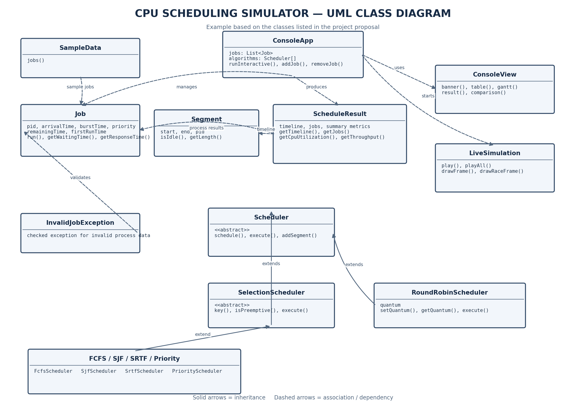
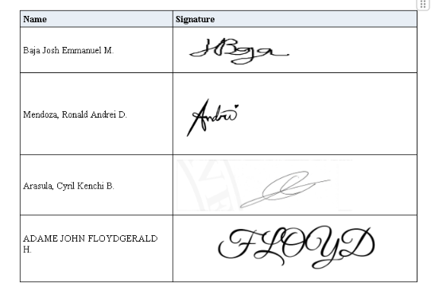

# 1. Project Title

# CPU Scheduling Simulator

*Developing and Designing a CPU Scheduling Simulator (Swing GUI and Console)*

> **Course:** OOP 101 -- Object-Oriented Programming\
> **Institution:** Batangas State University -- The National Engineering University, Alangilan Campus\
> **College / Department:** College of Informatics and Computing Sciences, Computer Science Department\
> **Academic Year:** 1st Semester, AY 2026--2027\
> **Team:** Group 2 (Section IT-2109)\
> **Repository:** [OOP-Final-PROJECT](https://github.com/nokromine-star/OOP-Final-PROJECT)

------------------------------------------------------------------------

## Table of Contents

1.  [Project Title](#1-project-title)
2.  [Project Description](#2-project-description)
3.  [Problem Being Addressed](#3-problem-being-addressed)
4.  [Project Objectives](#4-project-objectives)
5.  [Target Users](#5-target-users)
6.  [Main Features](#6-main-features)
7.  [Technologies Used](#7-technologies-used)
8.  [Team Members and Roles](#8-team-members-and-roles)
9.  [OOP Concepts Demonstrated](#9-oop-concepts-demonstrated)
10. [Instructions for Running the Program](#10-instructions-for-running-the-program)
11. [Sample Screenshots](#11-sample-screenshots)
12. [Known Limitations](#12-known-limitations)
13. [Future Improvements](#13-future-improvements)
14. [Project Contributors](#14-project-contributors)

------------------------------------------------------------------------

## 2. Project Description

CPU scheduling is an essential operating-system function: it decides which
process receives the CPU and for how long. Different scheduling algorithms
produce different waiting, turnaround, and response times, and different CPU
utilization, even for the same group of processes.

The **CPU Scheduling Simulator** is a Java application that simulates and
compares **FCFS, SJF, SRTF, Priority (non-preemptive and preemptive), Round
Robin, and HRRN**. It has two interfaces:

-   **Graphical interface (default).** A Swing window with a process table,
    an algorithm picker, an animated Gantt chart, an algorithm comparison, a
    live race, and a worked-solution tab.
-   **Console interface.** A text menu with colored tables and Gantt charts,
    started with `--console`.

Users build a workload, run an algorithm, inspect the Gantt chart and timing
results, watch the schedule replay one time unit at a time, and race all
algorithms on the same clock.

## 3. Problem Being Addressed

Scheduling algorithms are usually taught with hand-drawn Gantt charts and
manual computation. This is slow, error-prone, and makes it hard to compare
algorithms on the same workload.

-   **Who experiences the problem?** Students taking Operating Systems or
    related courses, and instructors who need a quick way to demonstrate and
    check scheduling results.
-   **Why does it matter?** Understanding how scheduling affects waiting
    time, turnaround time, and CPU utilization is a core operating-systems
    concept. A simulator makes it easier to learn and to verify answers.

## 4. Project Objectives

### General Objective

To develop a Java-based application that simulates and compares FCFS, SJF,
SRTF, Priority, Round Robin, and HRRN CPU scheduling, displaying Gantt charts,
performance metrics, and a live step-by-step simulation in both a graphical
and a console interface.

### Specific Objectives

-   Allow users to create, edit, remove, load, and randomly generate
    processes with validated arrival time, burst time, and priority.
-   Implement FCFS, SJF, SRTF, Priority (non-preemptive and preemptive),
    Round Robin with an adjustable time quantum, and HRRN.
-   Display colored Gantt charts, idle time, and per-process completion,
    turnaround, waiting, and response times.
-   Calculate average waiting, turnaround, and response times, CPU
    utilization, and throughput.
-   Compare all algorithms on the same workload.
-   Provide a live simulation and a live race that runs all algorithms
    together on the same clock.
-   Explain how each result is calculated with a worked example built from
    the user's own data.
-   Apply OOP concepts (classes, encapsulation, inheritance, polymorphism,
    abstraction, and exception handling) in the design.

## 5. Target Users

| Target User | How They Use the System |
|---|---|
| **Students** | Enter their own processes or load a sample or random workload, run an algorithm, and study the Gantt chart, metrics, and live simulation to learn how scheduling works. |
| **Instructors** | Demonstrate each algorithm step by step in class, run the live race to compare algorithms, and check students' hand-computed answers. |
| **Self-learners and developers** | Experiment with different workloads and time quanta to see how each algorithm behaves and which gives the best average waiting time. |

## 6. Main Features

| Feature | Description |
|---|---|
| Graphical Interface | Swing window with a splash screen, process table and form, algorithm picker, and four tabs: Simulation, Compare, Race, and How it's solved. |
| Console Interface | Text menu with colored tables and Gantt charts (`--console`, or automatically on a machine with no display). |
| Process Management | Add, update, and remove processes, clear the list, load sample data, and generate random workloads. |
| Input Validation | Validates arrival time, burst time, priority, and the Round Robin quantum. |
| Multiple Algorithms | FCFS, SJF, SRTF, Priority (non-preemptive and preemptive), Round Robin, and HRRN. |
| Gantt Chart | Colored scheduling timeline, including CPU idle periods. |
| Timing Table | Completion, turnaround, waiting, and response time for each process. |
| Performance Summary | Averages, CPU utilization, and throughput. |
| Algorithm Comparison | Runs all algorithms on the same workload; the best value in each column is highlighted, with a bar chart in the GUI. |
| Live Simulation | Replays one schedule one time unit at a time, with play, pause, step, and speed controls in the GUI. |
| Live Race | All algorithms progress side by side on a shared clock, ending with a podium. |
| Worked Solution | Step-by-step calculation of CT, TAT, WT, and RT for the user's own data (GUI tab "How it's solved", console option **W**). |

### Scheduling Algorithms

| Algorithm | Type | Description |
|---|---|---|
| First Come, First Served (FCFS) | Non-preemptive | Runs processes in arrival order. |
| Shortest Job First (SJF) | Non-preemptive | Picks the available process with the shortest burst time. |
| Shortest Remaining Time First (SRTF) | Preemptive | Picks the available process with the least remaining time. |
| Priority | Preemptive and non-preemptive | Picks by priority (lower number = higher priority). |
| Round Robin (RR) | Preemptive | Gives each ready process a time slice (the quantum). |
| Highest Response Ratio Next (HRRN) | Non-preemptive | Picks the highest response ratio, which grows as a process waits. |

### Performance Metrics

| Metric | Meaning |
|---|---|
| Completion Time (CT) | Time at which a process finishes. |
| Turnaround Time (TAT) | Time from arrival until completion. |
| Waiting Time (WT) | Time spent waiting in the ready queue. |
| Response Time (RT) | Time from arrival until the first CPU execution. |
| CPU Utilization | Percentage of elapsed time the CPU is busy. |
| Throughput | Completed processes per unit of elapsed time. |

``` text
Turnaround Time       = Completion Time - Arrival Time
Waiting Time          = Turnaround Time - Burst Time
Response Time         = First Start Time - Arrival Time
Average (any metric)  = Sum over all processes / Number of processes
CPU Utilization       = (CPU Busy Time / Total Elapsed Time) x 100%
Throughput            = Completed Processes / Total Elapsed Time
```

## 7. Technologies Used

| Technology | Use in the Project |
|---|---|
| **Java (JDK 21)** | Main programming language. |
| **Java Swing / AWT** | Graphical interface: windows, tables, panels, and custom-painted Gantt charts, race lanes, and bar charts. |
| **Java Console I/O** (`Scanner`, ANSI colors) | Text interface, menus, and colored console output. |
| **Java Collections** (`ArrayList`, `ArrayDeque`, arrays, `Comparator`) | Process lists, ready queues, timelines, and sorting. |
| **Git and GitHub** | Version control and team collaboration. |
| **UML class diagram** | Design documentation (see `docs/UML-Diagram.png`). |

## 8. Team Members and Roles

**Team Name:** Group 2  **Section:** IT-2109

| No. | Member | SR-Code | Role | Assigned Development Tasks |
|---:|---|---|---|---|
| 1 | ADAME, JOHN FLOYDGERALD H. | -- | Documentation Leader | Core model: `Job`, `Segment`, `ScheduleResult`, `InvalidJobException`, `SampleData`, and input validation. |
| 2 | ARASULA, CYRIL KENCHI B. | 25-06721 | Team Leader | Scheduling algorithms: `Scheduler`, `SelectionScheduler`, FCFS, SJF, SRTF, Priority, and Round Robin. |
| 3 | BAJA, JOSH EMMANUEL M. | 25-08885 | Lead Programmer | Live simulation and live race, testing and debugging, UML diagram, README, and presentation. |
| 4 | MENDOZA, RONALD ANDREI D. | 25-01770 | System / Design Lead | Console interface: `ConsoleApp` menu, `ConsoleView` tables and Gantt chart, and `Terminal` formatting. |

Names are listed alphabetically by last name, as required by the project proposal.

## 9. OOP Concepts Demonstrated

The source code is organized by OOP concept: each of the four main files
groups the classes that best show that concept.

| OOP Concept | Application in the Project |
|---|---|
| Classes and Objects | `Job`, `Segment`, `ScheduleResult`, `Workload`, and the scheduler classes represent processes, Gantt blocks, results, the process list, and algorithms. |
| Methods | Focused methods such as `schedule()`, `execute()`, `run()`, and `getWaitingTime()`. |
| **Encapsulation** (`Encapsulation.java`) | Model fields are private and reached through methods. `Job`, `Segment`, `ScheduleResult`, and `Workload` validate input and return unmodifiable views. Schedulers work on copies of the jobs. `RoundRobinScheduler` guards its quantum. |
| **Inheritance** (`Inheritance.java`) | `Scheduler` → `SelectionScheduler` → `FcfsScheduler`, `SjfScheduler`, `SrtfScheduler`, `PriorityScheduler`, `HrrnScheduler`; `Scheduler` → `RoundRobinScheduler`; `MenuItem` → `WorkloadItem` / `SimulationItem` / `SystemItem` → concrete menu entries. |
| **Polymorphism** (`Polymorphism.java`) | Algorithms are used through the `Scheduler` type and menu actions through `MenuItem`. `algorithm.schedule(jobs)` and `item.invoke(ctx)` run whichever subclass is behind the reference, with no large `switch`. Swing panels override `paintComponent()`. |
| **Abstraction** (`Abstraction.java`) | Interfaces `Describable` and `AppContext`, abstract classes `Scheduler`, `SelectionScheduler`, and `MenuItem`, and the `MenuGroup` enum define contracts and leave behavior to subclasses. `Scheduler.schedule()` is a final template method. |
| Exception Handling | A checked `InvalidJobException` for invalid process data; `IllegalArgumentException` for bad quantum values and empty process lists; menu input errors are caught in the menu loop and shown without crashing. |
| Arrays and Data Handling | A `Scheduler[]` holds the algorithms, `ArrayList` holds jobs, `ArrayDeque` is the Round Robin ready queue, and `Comparator` sorts results. |

### Class Design

The UML class diagram is in [`docs/UML-Diagram.png`](docs/UML-Diagram.png).

| Class | Responsibility |
|---|---|
| `Main` | Entry point. Opens the GUI by default; `--console` or `--demo` uses the text interface. |
| `Describable`, `AppContext` | Interfaces for anything with a name/code/summary, and for the services a menu action may use. |
| `MenuGroup` | Enum of the menu sections: Workload, Simulate, System. |
| `Job`, `Segment`, `ScheduleResult`, `Workload` | Model: a process, a Gantt block, a finished run, and the process list. |
| `SampleData`, `InvalidJobException` | Sample workload and the checked exception for invalid data. |
| `Scheduler`, `SelectionScheduler` | Abstract base classes for all algorithms. |
| `FcfsScheduler`, `SjfScheduler`, `SrtfScheduler`, `PriorityScheduler`, `HrrnScheduler`, `RoundRobinScheduler` | The concrete algorithms. |
| `MenuItem` and subclasses | Console menu entries (`AddProcessItem`, `RunAlgorithmItem`, `CompareItem`, `LiveRaceItem`, `ExitItem`, ...). |
| `ConsoleApp`, `ConsoleView`, `LiveSimulation`, `Terminal`, `LoadingScreen`, `CalcExplainer` | Console interface, output formatting, live replay/race, terminal utilities, and the worked solution. |
| `SchedulerGui`, `SplashWindow`, `SimulationPanel`, `RacePanel`, `ComparePanel`, `GanttPainter`, `ProcessTableModel`, `CellRenderer`, `HeaderRenderer`, `FlatButton`, `Theme` | Swing GUI. |

## 10. Instructions for Running the Program

### Requirements

-   Java Development Kit (JDK), tested with **JDK 21**
-   A terminal or command prompt
-   A desktop with a display for the GUI (the console interface works without one)

### Steps

``` bash
# 1. Clone the repository
git clone https://github.com/nokromine-star/OOP-Final-PROJECT.git

# 2. Open the source folder
cd OOP-Final-PROJECT/src

# 3. Compile (all files are in one folder, no packages)
javac *.java

# 4. Run
java Main
```

Running `java Main` opens the graphical interface. Optional flags:

| Flag | Effect |
|---|---|
| *(none)* | Opens the Swing GUI. |
| `--console` | Uses the text interface instead of the GUI. |
| `--demo` | Non-interactive text tour. |
| `--ascii` | Plain ASCII borders in the text interface. |
| `--no-intro` | Skips the loading screen. |

In an IDE, open the `src` folder, locate `Main.java`, and run it.

### Example Input

| Process | Arrival Time | Burst Time | Priority |
|---|---:|---:|---:|
| P1 | 0 | 5 | 2 |
| P2 | 1 | 3 | 1 |
| P3 | 2 | 8 | 3 |
| P4 | 3 | 2 | 2 |

*Illustrative only. For Round Robin, also set a time quantum.*

### Program Flow

Start → Main Menu → Select Operation (add process, run, compare, live simulation, live race) → Enter Information → Validate Input → Run Scheduling Algorithm (on a copy of the jobs) → Display Result → Return to Main Menu → Exit.

### Repository Structure

``` text
OOP-Final-PROJECT/
├── src/
│   ├── Main.java            # entry point (GUI or console)
│   ├── Abstraction.java     # interfaces, abstract classes, MenuGroup enum
│   ├── Encapsulation.java   # Job, Segment, ScheduleResult, Workload, utilities
│   ├── Inheritance.java     # scheduler and menu-item subclasses
│   └── Polymorphism.java    # console app, views, and GUI classes
├── docs/
│   ├── Project-Proposal.pdf
│   └── UML-Diagram.png
├── screenshots/
└── README.md
```

## 11. Sample Screenshots

### UML Class Diagram
<p align="center">
  
</p>

### Application Screenshots

> **TODO:** add screenshots of the running program to the `screenshots/`
> folder and keep only the lines for images that exist.

| Screen | Image |
|---|---|
| Main window with process table (GUI) | `` |
| Gantt chart and timing table | `` |
| Algorithm comparison | `` |
| Live race with podium | `` |
| Console menu | `` |

## 12. Known Limitations

-   Workloads cannot be saved to or loaded from a file or database; processes are kept in memory only.
-   No I/O bursts, multiple CPU cores, multilevel queues, or priority aging.
-   No context-switch overhead; switching between processes takes no time in the simulation.
-   No real operating-system processes; all processes are simulated from user-entered values limited to `0-10,000`.
-   The graphical interface needs a desktop with a display; without one, the program falls back to the console interface.

## 13. Future Improvements

-   Save and load workloads (for example, CSV or JSON files) and export results.
-   Add context-switch overhead as an adjustable setting.
-   Support I/O bursts and multiple CPU cores.
-   Add multilevel queue / multilevel feedback queue scheduling and priority aging.
-   Add more screenshots-ready export options, such as saving the Gantt chart as an image.

## 14. Project Contributors

| Name | GitHub |
|---|---|
| ADAME, JOHN FLOYDGERALD H. | -- |
| ARASULA, CYRIL KENCHI B. | [25-06721](https://github.com/25-06721) |
| BAJA, JOSH EMMANUEL M. | [nokromine-star](https://github.com/nokromine-star) |
| MENDOZA, RONALD ANDREI D. | [25-01770-del](https://github.com/25-01770-del) |

### Official Member Information and Signatures

<p align="center">
  
</p>

------------------------------------------------------------------------

Developed as a final project for **OOP 101 -- Object-Oriented Programming**,
Computer Science Department, College of Informatics and Computing Sciences,
Batangas State University -- The National Engineering University, Alangilan Campus.

<p align="center">
  <strong>CPU Scheduling Simulator</strong><br>
  OOP 101 -- Final Project | Group 2
</p>
